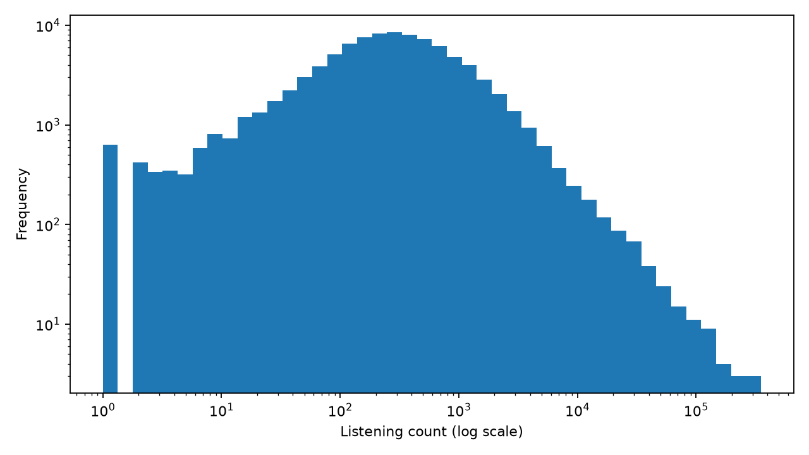
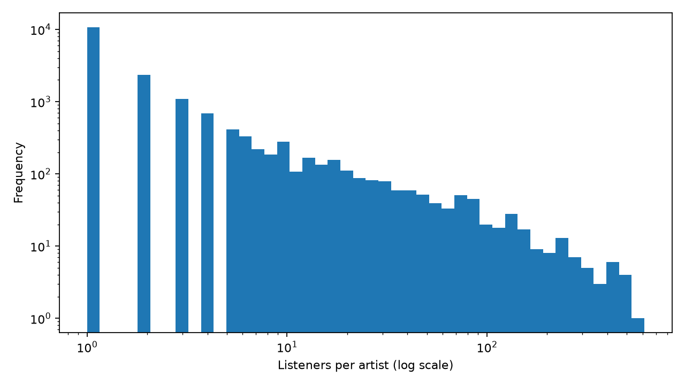
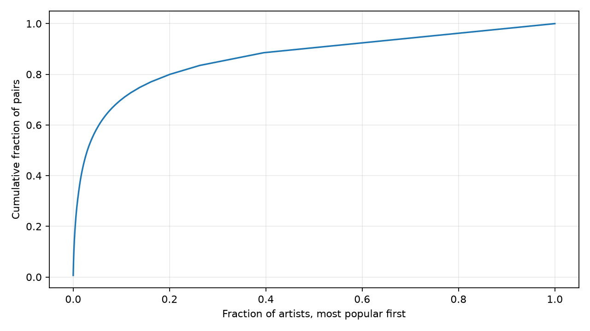

# Nghiên cứu HetRec 2011 Last.fm 2K

Nguồn: [GroupLens](https://grouplens.org/datasets/hetrec-2011/). Dùng phi thương mại; ghi nhận Last.fm và Cantador, Brusilovsky, Kuflik (2011).

SHA-256 ZIP: `6738f48195667ff03caaab4d32ca9a3133d8cc026b7c3cdaf6ce1010e913c59c`. Khớp bằng chứng kiểm tra trước trong dự án.

## Cấu trúc và chất lượng

`tags.dat` không phải UTF-8 hợp lệ; đọc CP1252 có thể mã hóa ngược bảo toàn byte. Các tệp còn lại đọc UTF-8 nghiêm ngặt. Cần kiểm tra ngữ nghĩa tag trước M2.

Có **1,892 người dùng**, **17,632 nghệ sĩ**, **92,834 cặp**. Mật độ 0.278282%; độ thưa 99.721718%. Số cặp không phải tổng lượt nghe; mỗi cặp mang trọng số phản hồi ngầm.

| Tệp | Số dòng | Trường |
|---|---:|---|
| artists.dat | 17,632 | id, name, url, pictureURL |
| tags.dat | 11,946 | tagID, tagValue |
| user_artists.dat | 92,834 | userID, artistID, weight |
| user_friends.dat | 25,434 | userID, friendID |
| user_taggedartists.dat | 186,479 | userID, artistID, tagID, day, month, year |
| user_taggedartists-timestamps.dat | 186,479 | userID, artistID, tagID, timestamp |

Không có interaction thiếu, trùng hoặc trọng số không hữu hạn/không dương. Kiểm tra liên kết: `{'tag_unknown_users': 0, 'tag_unknown_artists': 390, 'tag_unknown_tags': 0, 'friend_unknown_users': 0, 'friend_missing_reverse': 0, 'friend_self_loops': 0}`.

## Phân bố và hệ quả

Tổng trọng số lượt nghe quan sát: 69,183,975. Đây là tổng trên các cặp được thu thập, không phải lịch sử nghe toàn bộ của user.

| Phân bố | Min | P25 | P50 | P75 | P90 | P99 | Max |
|---|---:|---:|---:|---:|---:|---:|---:|
| Lượt nghe/cặp | 1.00 | 107.00 | 260.00 | 614.00 | 1,387.00 | 7,228.01 | 352,698.00 |
| Nghệ sĩ/user | 1.00 | 50.00 | 50.00 | 50.00 | 50.00 | 50.00 | 50.00 |
| Người nghe/nghệ sĩ | 1.00 | 1.00 | 1.00 | 3.00 | 8.00 | 81.00 | 611.00 |

Tỷ lệ cặp thuộc nhóm nghệ sĩ phổ biến nhất: top 10: 4.98%; top 100: 23.74%; top 1000: 60.99%.

Trung vị lượt nghe: 260; lớn nhất: 352,698. Lượt nghe lệch mạnh, không thể diễn giải trực tiếp như rating 1–5.

1829/1892 user có đúng 50 nghệ sĩ; 9 user dưới 3 và 15 user dưới 5. Given-N về sau phải được thiết kế bằng cách ẩn lịch sử, không suy ra rằng dữ liệu hiện tại đại diện đầy đủ cho người dùng mới.

14,804 nghệ sĩ có dưới 5 người nghe. Lọc item làm thay đổi long-tail, vì vậy không áp vào tái hiện không lọc.

| Bộ lọc khảo sát | Cặp | User | Nghệ sĩ |
|---|---:|---:|---:|
| user_min_5 | 92,801 | 1,877 | 17,617 |
| item_min_5 | 71,426 | 1,881 | 2,828 |
| both_single_pass | 71,411 | 1,874 | 2,828 |
| iterative_5_core | 71,355 | 1,859 | 2,823 |

## Tag, mạng xã hội và giới hạn

Tag phủ 12,133/17,632 nghệ sĩ (68.81%) và 1,892 user. Có 12,717 cạnh bạn bè vô hướng.
1,892/1,892 user có ít nhất một bạn; trung vị bậc bạn bè 6, lớn nhất 119. Bậc này tính cả user không có bạn bằng 0.
Có 12,523 ID nghệ sĩ trong tệp tag; 390 ID ngoài metadata, tương ứng 1,538 lượt gắn tag. Độ phủ ở trên dùng giao với catalog, không lấy toàn bộ ID tag chia cho số nghệ sĩ.

Ngày tag không hợp lệ theo lịch: 0. Timestamp là thời điểm gắn tag, không phải thời điểm nghe. Các tag cũng là dữ liệu tương tác: M2 phải kiểm soát nguồn tag của các cặp bị giữ lại.

## Hình sinh tự động

Tái tạo: `python scripts/research.py analyze`. Chi tiết định lượng, schema, quantile và checksum từng tệp nằm trong artifact `dataset_analysis.json`.

MLflow run: `f9a28ca67b12451bab43aff681e30bb2`.
