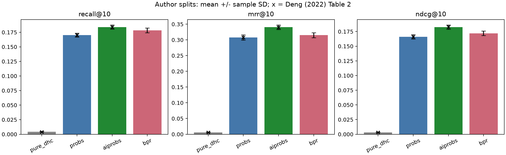

# Báo cáo tái hiện HetRec LastFM

Tái hiện một phần thực nghiệm LastFM trong Deng (2022), gồm Pure-DHC, ProbS và AIProbS trên 30 split công khai; đối chứng BPR dựa trên benchmark RecBole-GNN. Trạng thái thực tế được xác định bởi số lượt hoàn tất dưới đây.

Nguồn chính: [Deng (2022), Bảng 2](https://doi.org/10.1038/s41598-022-21607-4). Nguồn BPR: [benchmark LastFM](https://github.com/RUCAIBox/RecBole-GNN/blob/9092ac4452224c9c1754d8c4b89b4eb2abaaf71f/results/social/lastfm.md).

| Giao thức | Mô hình | Hoàn tất / yêu cầu | Recall@10 | MRR@10 | NDCG@10 |
|---|---|---:|---:|---:|---:|
| aiprobs-original | pure_dhc | 30/30 | 0.004164 ± 0.000819 | 0.006012 ± 0.001107 | 0.003215 ± 0.000584 |
| aiprobs-original | probs | 30/30 | 0.170085 ± 0.003240 | 0.307744 ± 0.007974 | 0.165877 ± 0.003626 |
| aiprobs-original | aiprobs | 30/30 | 0.183943 ± 0.003575 | 0.340353 ± 0.007006 | 0.182590 ± 0.003568 |
| aiprobs-original | bpr | 30/30 | 0.178433 ± 0.004057 | 0.314977 ± 0.008007 | 0.172022 ± 0.003934 |
| recbole-bpr-benchmark | bpr | 3/3 | 0.179137 ± 0.003231 | 0.318708 ± 0.005319 | 0.173440 ± 0.001813 |

**Trạng thái: đủ 123 lượt đánh giá đã chọn.**

Số công bố, độ lệch tuyệt đối/tương đối và độ lệch chuẩn được xuất trong `results-summary.csv`; `results-per-split.csv` truy tới MLflow run từng lượt. Không gộp hai giao thức hoặc coi 30 split là 30 dataset độc lập.

## Giới hạn và điều chỉnh

- AIProbS dùng nhánh DHC/cosine/max-min+mean của mã tác giả. Công thức (4) in trong bài và phép chia trọng số cho tổng trong code khác nhau; phép chia trong mã được giữ làm chuẩn tái hiện code.
- Python/PyTorch hiện đại và lưu trữ thưa thay thế cấp phát ma trận đồ thị đặc. Kiểm chứng tham chiếu được lưu riêng; không gọi bản vá bộ nhớ là chạy nguyên bản.
- BPR benchmark dùng split mới từ dữ liệu chính thức, seed 2020/2021/2022. Không có hash split hoặc môi trường đầy đủ của kết quả công bố để xác nhận tái hiện bit-for-bit.
- Coverage, ARP và novelty là phân tích bổ sung. ARP dùng số người nghe trong train; novelty = mean[-log2((listeners+1)/(users+1))], loại padding khỏi users.
- Đồng điểm dùng torch.topk CPU trên thứ tự ID nguồn trong thí nghiệm; API recommend dùng thứ tự ID ổn định để phục vụ ứng dụng.

## Liên hệ với khóa luận

Các kết quả này kiểm chứng nền tảng đánh giá implicit Top-N. Giai đoạn M1 cần so sánh độ chính xác cùng coverage/ARP và M2 cần kiểm soát rò rỉ tag. Không chuyển đổi trực tiếp số bài báo sang giao thức min-user-5, proxy rating hoặc warm-start của khóa luận. Bản DOCX hiện tại được giữ nguyên.

## Kiểm chứng và điều kiện nghiệm thu

Trạng thái nghiệm thu: **completed**. Có 123/123 lượt đánh giá hoàn tất.

| Kiểm tra | Đạt |
|---|---|
| all_123_evaluations | Có |
| all_123_native_metric_checks | Có |
| tiny_reference | Có |
| full_reference | Có |
| 33_split_integrity_checks | Có |
| dataset_analyzed | Có |
| quality_checks | Có |
| repeatability | Có |
| bpr_checkpoint_recovery | Có |

Thanh sai số là độ lệch chuẩn mẫu giữa các split, không phải khoảng tin cậy của 30 dataset độc lập. Dấu x là số xuất bản, có độ chính xác ba chữ số thập phân.

## Sai khác với số công bố

| Giao thức | Mô hình | Metric | Công bố | Chạy lại | Chênh lệch |
|---|---|---|---:|---:|---:|
| aiprobs-original | aiprobs | recall@10 | 0.1840 | 0.183943 | -0.000057 |
| aiprobs-original | aiprobs | mrr@10 | 0.3400 | 0.340353 | +0.000353 |
| aiprobs-original | aiprobs | ndcg@10 | 0.1830 | 0.182590 | -0.000410 |
| aiprobs-original | probs | recall@10 | 0.1700 | 0.170085 | +0.000085 |
| aiprobs-original | probs | mrr@10 | 0.3080 | 0.307744 | -0.000256 |
| aiprobs-original | probs | ndcg@10 | 0.1660 | 0.165877 | -0.000123 |
| aiprobs-original | pure_dhc | recall@10 | 0.0040 | 0.004164 | +0.000164 |
| aiprobs-original | pure_dhc | mrr@10 | 0.0060 | 0.006012 | +0.000012 |
| aiprobs-original | pure_dhc | ndcg@10 | 0.0030 | 0.003215 | +0.000215 |
| recbole-bpr-benchmark | bpr | recall@10 | 0.1761 | 0.179137 | +0.003037 |
| recbole-bpr-benchmark | bpr | mrr@10 | 0.3026 | 0.318708 | +0.016108 |
| recbole-bpr-benchmark | bpr | ndcg@10 | 0.1674 | 0.173440 | +0.006040 |
| recbole-bpr-benchmark | bpr | hit@10 | 0.5573 | 0.570594 | +0.013294 |
| recbole-bpr-benchmark | bpr | precision@10 | 0.0858 | 0.087739 | +0.001939 |

Các chênh lệch được giữ nguyên. Không chọn siêu tham số bằng test để ép khớp bài báo.
Cả ba mô hình đã đủ 30 split; 9/9 số trung bình metric chính khớp số công bố khi làm tròn ba chữ số. Đây là bằng chứng ở mức bảng kết quả; kiểm chứng thuật toán/evaluator được thực hiện riêng.
Trên 30 split chung, AIProbS − ProbS có NDCG@10 trung bình +0.016713, độ lệch chuẩn 0.001331; AIProbS cao hơn trên 30 split.
Trên 30 split chung, AIProbS − BPR có NDCG@10 trung bình +0.010568, độ lệch chuẩn 0.003301; AIProbS cao hơn trên 30 split.

**Mức xác nhận BPR benchmark:** đã chạy đủ ba seed theo giao thức khôi phục, nhưng các số mới không khớp bảng công bố. Split, thứ tự ID và lock môi trường gốc chưa được cung cấp đầy đủ; chưa xác nhận tái hiện chính xác bảng benchmark. Trạng thái `completed` ở đây xác nhận đủ khối lượng chạy/kiểm chứng đã chốt. Cần bằng chứng split và môi trường gốc để xác định nguyên nhân chênh lệch. Không diễn giải điểm cao hơn thành cải tiến thuật toán BPR.

## Chi phí và phân tích bổ sung

[Chi phí từng lượt](runtime-per-split.csv) tách thời gian nạp factor của adapter khỏi thời gian huấn luyện và đánh giá RecBole. Không dùng thời gian nạp factor để kết luận BPR huấn luyện nhanh hơn diffusion. RSS được đo sau đánh giá, không phải peak RAM; giới hạn này được giữ trong tên cột.
Thời gian native BPR là thời gian invocation cuối. Nếu có lượt tiếp tục, thời gian invocation trước được ghi riêng trong `outputs/research/resume_events.json`, không cộng ngầm vào cột này.

[Coverage, ARP, novelty](supplementary-metrics.csv) được tính trên cùng ranking và popularity của train. Coverage có hai mẫu số: catalog đầy đủ và item có train. Novelty dùng làm trơn cộng một; không phải metric công bố của Deng (2022).

| Giao thức | Mô hình | Coverage catalog | ARP | Novelty (bit) |
|---|---|---:|---:|---:|
| aiprobs-original | aiprobs | 4.56% | 201.20 | 3.574 |
| aiprobs-original | bpr | 9.95% | 149.28 | 4.326 |
| aiprobs-original | probs | 4.07% | 230.92 | 3.330 |
| aiprobs-original | pure_dhc | 1.46% | 59.91 | 5.155 |
| recbole-bpr-benchmark | bpr | 10.59% | 145.22 | 4.389 |

Coverage là độ phủ catalog, chưa đo đa dạng ngữ nghĩa trong từng danh sách. ARP thấp hoặc novelty cao cần được đọc cùng Recall/NDCG: Pure-DHC có ít hit dù ARP thấp. Các đối chứng đã chạy cung cấp căn cứ thiết kế trade-off cho M1.

## Đề xuất cập nhật khóa luận

1. Giữ ProbS/AIProbS và BPR làm đối chứng đã kiểm chứng cho artist Top-N. Pure-DHC hữu ích như ablation, độ chính xác thấp không đủ làm baseline mạnh.
2. Thống nhất giao thức thesis 80/10/10 trong ADR trước khi thay scaffold leave-one-out; báo cáo rõ warm-start, catalog và user bị loại.
3. M1 nên đo đồng thời NDCG/Recall, coverage và ARP trên cùng split; không áp item-min-5 rồi diễn giải long-tail như dữ liệu gốc.
4. M2 phải xử lý artist ID tag không có metadata và giới hạn 68,81% độ phủ tag trong catalog. Timestamp tag không cung cấp lịch sử nghe theo thời gian. Tránh sử dụng tag phát sinh sau mốc train khi giao thức tương lai có mốc thời gian.
5. Kiểm tra nhóm lịch sử ngắn bằng thiết kế thí nghiệm rõ ràng: 1.829/1.892 user đã có đúng 50 artist; các kết luận cold-user từ dữ liệu tự nhiên sẽ rất hạn chế.

Bản DOCX gốc được giữ nguyên. Pipeline ứng dụng, M1/M2 và các baseline thesis còn lại không nằm trong nghiệm thu tái hiện lần này.

Tiếp tục thực tế: aiprobs-original/split 1 từ checkpoint epoch 242; invocation trước đã ghi nhận 146.70 giây.

Máy chạy CPU: 12 core vật lý, 16 luồng logic, 15.71 GiB RAM; Torch dùng 4 luồng. Lock môi trường chính: `uv.lock`; môi trường legacy: `requirements/legacy-reproduction.txt`.
